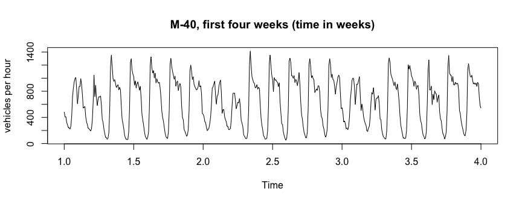
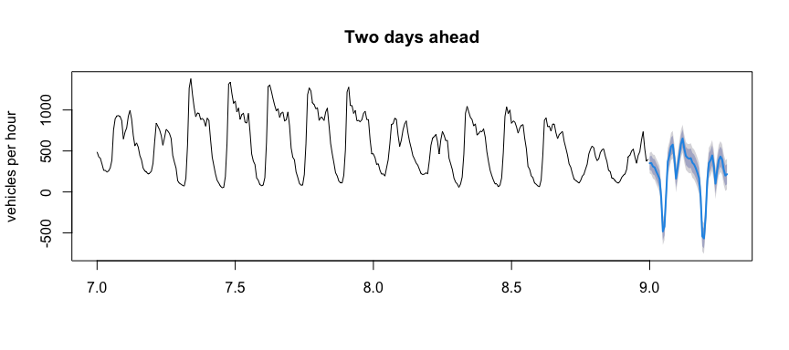

<!-- README.md is generated from README.Rmd. Please edit that file -->

# msarima 

<!-- badges: start -->

[](https://github.com/danigiro/msarima/actions/workflows/R-CMD-check.yaml)
[](https://CRAN.R-project.org/package=msarima)
[](https://github.com/danigiro/msarima)
[](https://cran.r-project.org/web/licenses/GPL-3)
<!-- badges: end -->

The `msarima` package fits ARIMA models with **more than one seasonal
component**. Series observed at high frequency often carry several
cycles at once, such as the daily *and* the weekly pattern of hourly
data, while `stats::arima()` can only take one of them. The package
gives each period its own autoregressive, differencing and moving
average operator, estimated by conditional maximum likelihood.

- `msarima()` fits the model, with support for fixed coefficients and a
  constant term.
- `forecast()` produces point forecasts and prediction intervals.
- `msarima.sim()` and `simulate()` simulate from a specification or from
  a fit.
- `sacf()` and `spacf()` draw correlograms that mark the lags of each
  cycle (`ggsacf()` and `ggspacf()` for the `ggplot2` versions).
- `msportmanteau()` runs the multi-seasonal Ljung-Box and Monti
  portmanteau tests on a series or on the residuals of a fit.

## Installation

You can install the stable version from
[CRAN](https://CRAN.R-project.org/package=msarima):

``` r
install.packages("msarima")
```

You can install the development version from
[GitHub](https://github.com/danigiro/msarima):

``` r
# install.packages("devtools")
devtools::install_github("danigiro/msarima")
```

## Usage

`MAD_m40` is the hourly number of vehicles recorded by a sensor on the
M-40 ring road of Madrid over the eight weeks from 3 February to 29
March 2024. It is an `msts` object with periods 24 and 168, so the
periods do not have to be repeated in every call.

``` r
library(msarima)

plot(window(MAD_m40, end = 4), ylab = "vehicles per hour",
     main = "M-40, first four weeks (time in weeks)")
```



Both the daily cycle and the weekly one (weekends clearly lower) are
visible. `order` sets the non-seasonal part, `seasonal` takes one
`c(P, D, Q)` per period:

``` r
fit <- msarima(MAD_m40,
               order = c(1, 0, 2),
               seasonal = list(c(0, 1, 1), c(0, 1, 1)))
fit
#> Series: MAD_m40 
#> mSARIMA(1,0,2)(0,1,1)[24](0,1,1)[168]
#> 
#> Coefficients:
#>    AR(1)    MA(1)    MA(2) SMA(1,1) SMA(2,1) 
#>   0.8847  -0.3737  -0.0906  -0.5603  -0.6836 
#> 
#> sigma^2 = 4009.7288  log likelihood = -5356.48
#> AIC = 10724.97   AICc = 10725.04   BIC = 10755.26
```

`summary()` adds standard errors and significance tests:

``` r
summary(fit)
#> Series: MAD_m40 
#> mSARIMA(1,0,2)(0,1,1)[24](0,1,1)[168]
#> 
#> Coefficients:
#>          Estimate Std. Error z value Pr(>|z|)    
#> AR(1)     0.88473    0.02473  35.770   <2e-16 ***
#> MA(1)    -0.37373    0.04060  -9.204   <2e-16 ***
#> MA(2)    -0.09059    0.03805  -2.381   0.0173 *  
#> SMA(1,1) -0.56029    0.02700 -20.748   <2e-16 ***
#> SMA(2,1) -0.68362    0.02525 -27.072   <2e-16 ***
#> ---
#> Signif. codes:  0 '***' 0.001 '**' 0.01 '*' 0.05 '.' 0.1 ' ' 1
#> 
#> sigma^2 = 4009.7288  log likelihood = -5356.4828
#> AIC = 10724.9656   AICc = 10725.0390   BIC = 10755.2612
```

### Forecasting

``` r
fc <- forecast(fit, h = 48)
plot(fc, include = 336, main = "Two days ahead", ylab = "vehicles per hour")
```



### Simulation

``` r
set.seed(1)
y <- msarima.sim(nsim = 500,
                 order = c(1, 0, 1),
                 seasonal = list(c(0, 0, 1), c(0, 0, 1)),
                 seasonal.period = c(7, 30),
                 ar = 0.6, ma = c(0.4, 0.3, 0.2),
                 sigma2 = 0.5)

y_sim <- simulate(fit, nsim = 168, seed = 1)
```

### Fixing parameters

`fixed` takes one entry per parameter, `NA` where the parameter is to be
estimated. The order is AR, seasonal AR, MA, seasonal MA, sigma:

``` r
fit_fixed <- msarima(MAD_m40,
                     order = c(1, 0, 2),
                     seasonal = list(c(0, 1, 1), c(0, 1, 1)),
                     fixed = c(NA, NA, NA, -0.6, NA, NA))
c(free = AIC(fit), fixed = AIC(fit_fixed))
#>     free    fixed 
#> 10724.97 10725.21
```

## Learn more

`vignette("msarima")` walks through the package on `MAD_m40`, from the
correlograms to model choice and forecast evaluation.

## References

Lisi, F. and Grigoletto, M. (2025). Multiple seasonal autoregressive
integrated moving average models. *Journal of Forecasting*, **44**(6),
2037-2052. <https://doi.org/10.1002/for.3283>

Grigoletto, M. and Lisi, F. (2026). Portmanteau goodness-of-fit tests in
the presence of simple, mixed, and multiple seasonal autocorrelation.
*arXiv*. <https://doi.org/10.48550/arXiv.2609.32381>
