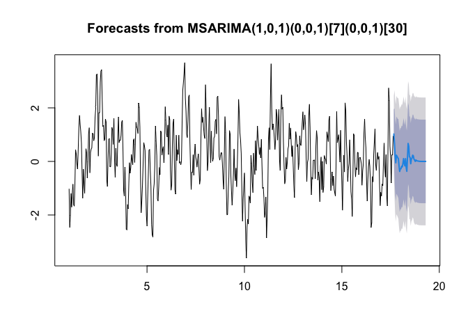

<!-- README.md is generated from README.Rmd. Please edit that file -->

# msarima: Multi-Seasonal ARIMA Models

<!-- badges: start -->

<!-- badges: end -->

The **msarima** package provides tools for fitting, forecasting, and
simulating ARIMA models with multiple seasonal components. It extends
the standard ARIMA framework to handle time series with multiple
seasonal patterns.

## Installation

You can install the development version of msarima from
[GitHub](https://github.com/danigiro/msarima) with:

``` r
# install.packages("devtools")
devtools::install_github("danigiro/msarima")
```

Once available on [CRAN](https://CRAN.R-project.org/package=msarima)
(soon), you can install the released version with:

``` r
install.packages("msarima")
```

## Features

- **Maximum likelihood estimation**: Uses numerical optimization (BFGS)
  for parameter estimation
- **Forecasting**: Generate point forecasts and prediction intervals
- **Simulation**: Simulate from fitted models or directly from model
  specifications
- **Time series support**: Works with `msts` objects
- **Model diagnostics**: Standard errors, information criteria (AIC,
  BIC, AICc)

## Basic Usage

``` r
library(msarima)
#> Loading required package: forecast
#> Warning: package 'forecast' was built under R version 4.5.2
#> Registered S3 method overwritten by 'quantmod':
#>   method            from
#>   as.zoo.data.frame zoo

# Simulate data with two seasonal components (periods 7 and 30)
set.seed(123)
y <- msarima.sim(
  nsim = 500,
  order = c(1, 0, 1),
  seasonal = list(c(0, 0, 1), c(0, 0, 1)),
  seasonal.period = c(7, 30),
  ar = 0.6,
  ma = c(0.4, 0.3, 0.2),  # non-seasonal MA, seasonal MA1, seasonal MA2
  sigma2 = 0.5
)

# Fit the model
fit <- msarima(
  y,
  order = c(1, 0, 1),
  seasonal = list(c(0, 0, 1), c(0, 0, 1)),
  seasonal.period = c(7, 30)
)

# View results
summary(fit)
#> Series: y 
#> MSARIMA(1,0,1)(0,0,1)[7](0,0,1)[30]
#> 
#> Coefficients:
#>        Estimate Std. Error z value Pr(>|z|)    
#> AR      0.58700    0.04535  12.943  < 2e-16 ***
#> AR      0.38158    0.05050   7.556 4.14e-14 ***
#> SMA1.1  0.28138    0.04571   6.156 7.47e-10 ***
#> SMA2.1  0.24272    0.04468   5.433 5.56e-08 ***
#> ---
#> Signif. codes:  0 '***' 0.001 '**' 0.01 '*' 0.05 '.' 0.1 ' ' 1
#> 
#> sigma^2 = 0.5252  log likelihood = -88.9814
#> AIC = 187.9628   AICc = 188.0842   BIC = 209.0358
```

### Forecasting

``` r
# Generate forecasts
fc <- forecast(fit, h = 50)
plot(fc)
```



### Working with msts Objects

``` r
y_msts <- msts(y, seasonal.periods = c(7, 30))
fit_msts <- msarima(
  y_msts,
  order = c(1, 0, 1),
  seasonal = list(c(0, 0, 1), c(0, 0, 1))
)
```

## Citation

If you use this package in your research, please cite:

    @Manual{,
      title = {msarima: Multi-Seasonal ARIMA Models},
      author = {Girolimetto, Daniele and Lisi, Francesco and Grigoletto, Matteo},
      year = {2025},
      note = {R package version 1.0.0},
      url = {https://github.com/danigiro/msarima},
    }

    @article{Lisi2025,
      title     = "Multiple seasonal autoregressive integrated moving average models",
      author    = "Lisi, Francesco and Grigoletto, Matteo",
      journal   = "Journal of Forecasting",
      publisher = "Wiley",
      volume    =  44,
      number    =  6,
      pages     = "2037--2052",
      year      =  2025,
      doi       = "10.1002/for.3283"
    }

## Contributing

Contributions are welcome! Please feel free to submit a Pull Request.

## Issues

If you encounter any bugs or have feature requests, please file an issue
at: \[<https://github.com/yourusername/msarima/issues>\]
